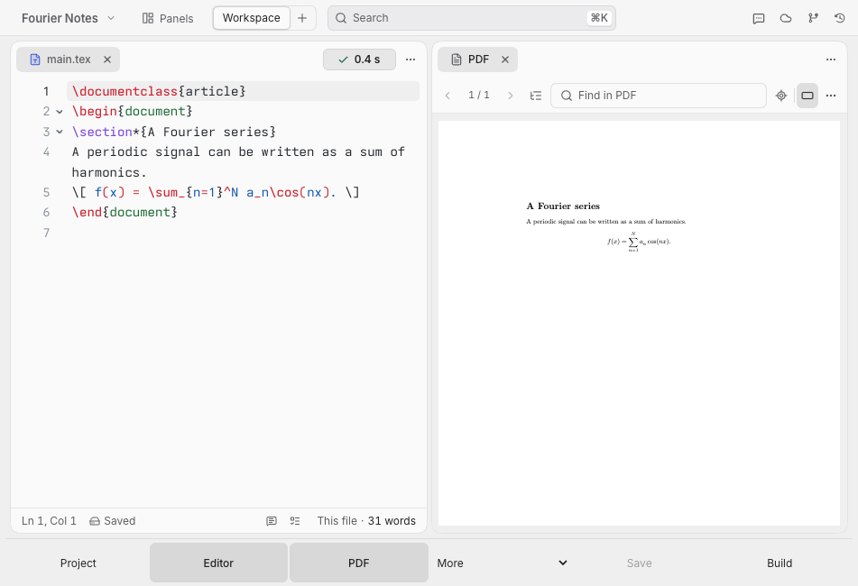

# Installable mobile workspace

Open your workspace in the browser you plan to install it from. For a new
phone on a workspace with device pairing, scan the owner's **Pair a device**
code and choose **Connect this device**. For an account gateway, open its
HTTPS address and sign in with the account the owner approved. For a private
Tailscale address, connect to the tailnet first. A workspace configured for
token sign-in prompts its owner for the server access token.

Once you see the editor, choose **Share → Add to Home Screen** in iPhone
Safari. On a desktop, look for **Install app** in the address bar or browser
menu. See the [standalone server guide](headless-web-client.md) for the sign-in
options and how to reconnect with edits still open. On browsers that support
the Launch Handler API, opening the installed app again focuses the existing
workspace window and keeps the current document in place. If a revoked device
opens a new pairing invitation in that window, confirm the device name there
to reconnect with the editor still open.

On a standalone server, the workspace shows one panel at widths up to 640 CSS
pixels. From 641 to 1024 pixels, it opens the editor and PDF side by side.
The bottom bar highlights the visible panels. Opening a project file brings
its editor forward. Unfolding keeps the current edit and text selection.
Above 1024 pixels the workspace restores the desktop layout.

The service worker is registered only on the standalone server, in a secure
context. It is network-only: it does not cache HTML, project data, API responses,
or authentication. When the server cannot be reached, opening the app displays a
reconnection page. Editing requires the live server. Installing the app does not
make the server public or bypass its authentication. Native Tauri windows and
single-use desktop browser handoffs do not register this worker.

Supported operations still depend on the connected server's capabilities.
Installation and a mobile layout do not add a terminal, an AI backend, or a LaTeX
distribution to the server.
